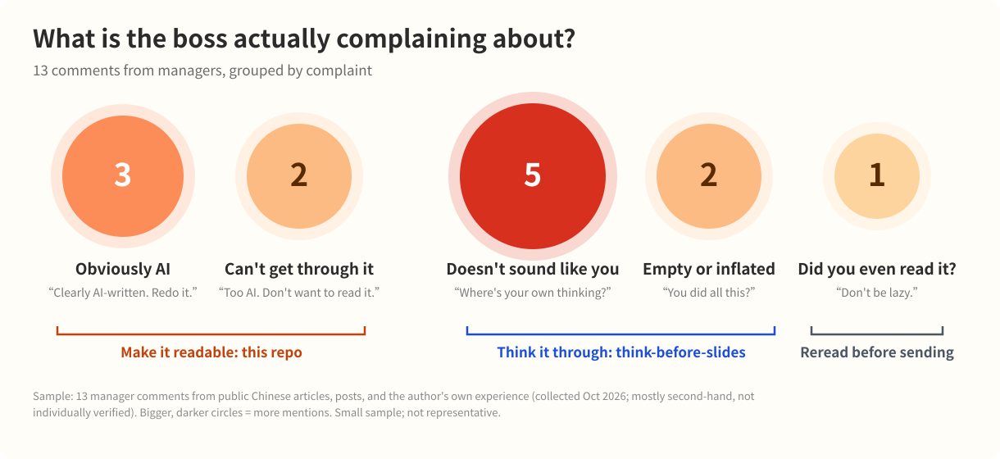

<p align="center">
  
</p>

# Make AI Write Chinese Like a Human

[中文](README.md) | **English**

A Chinese writing skill for AI agents: seven checkable rules for clearer prose, with meaning preservation as the first requirement. Use it to draft, rewrite, or review Chinese reports, articles, posts, and documentation.

[Install and try it](#get-started) · [Changelog](CHANGELOG.md) · [Citation](CITATION.cff)

> "Not human. Too AI. I don't want to read this."
>
> "Did you even read this yourself? Use AI properly. Don't be lazy."
>
> "This report was written by AI, wasn't it? Where's your own thinking?"
>
> "It's well written... it just doesn't sound like you."
>
> "You did all this this week? News to me."

If you use AI to write reports in Chinese, you've probably heard one of these from a manager. (Translated from Chinese. The first two come from the author's own experience; the rest from public articles and posts. Originals and sources: [docs/boss-quotes.md](docs/boss-quotes.md).)



The complaints fall into three groups:
- **Hard to read, obviously AI**: this repo. Seven checkable writing rules for AI agents that write Chinese.
- **Doesn't sound like you, empty, inflated**: you need to work out what you're saying first. Use the companion skill [think-before-slides](https://github.com/robox888/think-before-slides) (Chinese).
- **Did you even read it?**: no tool fixes this. Read it yourself before sending.

---

## The same habits show up in English

Read this sentence:

> *Your instinct is right; the convoluted sentence you are currently reading is quietly eating its own reader-patience budget — footnote it.*

It sounds like a modern LLM. That's the opening line of [Clark, Martin & Mahowald (2026)](https://arxiv.org/abs/2610.29162), written to pack four features that make text harder to process and that frontier models overuse:

- an object relative clause
- a noun turned into a verb ("footnote it")
- an inanimate subject doing something only living things do ("a sentence ... eating")
- stacked nouns forming a rare phrase ("reader-patience budget")

**Chinese AI text has the same habits, and Chinese has no spaces between words to help the reader parse them.** This skill makes those habits visible and gives the agent a rule for each one. A worked example, a weekly report rewritten step by step, is on the [Chinese page](README.md#一份被打回的周报).

---

## The 7 rules

Each row shows a typical AI phrasing and a human rewrite, with a literal English gloss.

| # | Rule | AI tends to write | A human would write |
|---|---|---|---|
| 1 | Say how sentences connect | 转化率降了 3%。工单量没变。先不回滚。<br>*Conversion fell 3%. Tickets unchanged. Not rolling back.* | 转化率降了 3%，不过工单量没变，我们判断影响有限，所以先不回滚。<br>*Conversion fell 3%, but tickets didn't change, so we judge the impact limited and won't roll back yet.* |
| 2 | Max two layers of modifiers before a noun | 用户行为数据分析模型优化方案<br>*user-behavior-data-analysis-model optimization plan* | 我们有一个分析用户行为数据的模型，请针对它提交优化方案。<br>*We have a model that analyzes user behavior data. Please propose how to improve it.* |
| 3 | Don't let abstractions act like people | 这个框架吞噬了团队大量时间。<br>*This framework devoured the team's time.* | 团队在这个框架上花了大量时间。<br>*The team spent a lot of time on this framework.* |
| 4 | Use everyday word pairings; watch word boundaries | 对齐颗粒度、日历化<br>*align the granularity, calendarize it* | 核对细节、排进日程<br>*check the details, put it on the schedule* |
| 5 | Common words; one term per concept | 该方法……该范式……这一路径……<br>*this method ... this paradigm ... this pathway ...* | 这个方法……它……它……<br>*this method ... it ... it ...* |
| 6 | Smooth locally, vary rhythm overall | Three sentences of equal length, each "X, thereby Y" | Follow a long sentence with a short one or an example |
| 7 | Cut stock phrases and over-answering | 这是个好问题。在当今……综上所述……<br>*Great question. In today's ... In summary ...* | Answer first, then give the reason |

Rule 0 sits above all of them: **a rewrite must not change the meaning.** If the source doesn't state a cause or a number, the agent must not invent one. It marks the gap as `[待确认]` (to be confirmed).

More examples (in Chinese) are in [docs/examples.md](docs/examples.md).

In rule 1, use "we judge the impact limited" only if the author confirms that this was the actual reason. Do not add that judgment when the source does not support it.

---

## Get started

**Install as a skill** (Claude Code shown):

```bash
git clone https://github.com/robox888/human-readable-chinese-writing.git \
  ~/.claude/skills/human-readable-chinese-writing
```

For a project-only installation, clone into the project's `.claude/skills/` directory. On Windows (PowerShell):

```powershell
git clone https://github.com/robox888/human-readable-chinese-writing.git "$HOME\.claude\skills\human-readable-chinese-writing"
```

The skill instructs the agent to follow the seven rules when writing or editing Chinese. Other tools that support `SKILL.md` can use their own skill directories; check the tool's discovery requirements.

Start a new session and try:

```text
根据下面的工作记录，帮我写一段周报。不要夸大，不要编造缺失的信息：
参加了评审会；搭了个数据看板；看了下用户反馈的分析流程。
```

Check that the output avoids stock openings, inflated credit such as "主导" (led), and invented outcomes. Missing details should be marked `[待确认]`. This is a basic output check; writing style alone does not prove that the skill was loaded.

Update an installation cloned from this repository:

```bash
git -C ~/.claude/skills/human-readable-chinese-writing pull
```

To uninstall, remove the installed skill folder after saving any local changes you want to keep.

**Rules only**: paste [rules/AGENTS-snippet.md](rules/AGENTS-snippet.md) into your project's `AGENTS.md`, `CLAUDE.md`, or system prompt. The rules are written in Chinese, which is what the model needs when it writes Chinese.

**Use both**: settle the goal, evidence, and outline with [think-before-slides](https://github.com/robox888/think-before-slides) first, then write the text with this skill.

---

## Why AI text got harder to read

A cluster of 2026 papers looked at this directly:

- One explanation is post-training. Models are increasingly trained on math, code, and reasoning, where a correct answer is rewarded and a clear one is not. Long outputs can also be penalized, which pushes models to pack more information into fewer words. Clark et al. offer a length-penalty fine-tuning experiment as a proof of concept.
- Researchers observed more stacked nouns, rare word combinations, and abstract subjects in AI text than in human writing. In one study, LLM rewrites had 2.66% fewer words but a 1.57% longer predicted reading time per word.
- Models also rotate synonyms, reuse stock phrases, and give several overlapping answers. In a hardware-description-language Q&A study, engineers flagged 65.7% of LLM answers as redundant, compared with 4.4% of accepted human answers.

Sources, key numbers, and how strong the evidence is for each rule: [docs/evidence.en.md](docs/evidence.en.md).

---

## What's in this repo

| File | For | Contents |
|---|---|---|
| `SKILL.md` | AI | Skill entry: when to trigger, the 7-step process, a self-check list |
| `rules/AGENTS-snippet.md` | AI | Rules to paste into `AGENTS.md` / `CLAUDE.md` |
| `README.md` / `README.en.md` | People | This page |
| `docs/examples.md` | People | All rewrite examples (Chinese) |
| `docs/boss-quotes.md` | People | The 13 manager comments behind the chart, with sources (Chinese) |
| `docs/evidence.md` / `docs/evidence.en.md` | People | Research basis and evidence strength |
| `assets/` | People | Images; `assets/src/` holds the chart data and the script that draws it |
| `CHANGELOG.md` / `CITATION.cff` | People | Version history and citation metadata |
| `.github/` | Contributors | Issue forms and automated file, version, and link checks |

---

## Limitations

- Only 1 of the 9 papers studies Chinese. Applying the rest to Chinese is an inference.
- Thresholds like "two layers" and "two sentences" are rules of thumb; the papers don't give them.
- The over-answering study also found that participants rated the LLM answer as more readable in 58.3% of cases. Readable is not always the same as concise or accurate.
- The manager-comment sample is only 13 items, mostly second-hand; it shows rough categories, not proportions.
- The rules address readability. Whether the content is correct needs a separate check.
- There is no controlled comparison of results with and without this skill yet; the observed benefits remain case-based.

## FAQ

**Will this change my meaning?** The rules require the agent to preserve it and mark missing facts. Models can still fail to follow instructions, so review the output.

**Will this bypass AI detectors?** No. The goal is readability, and no detection outcome is guaranteed.

**Are the numeric thresholds research findings?** No. "Two layers" and "two sentences" are practical heuristics, not measured cutoffs from the papers.

**Do I need Claude Code?** No. Use a tool that supports skills, or paste [the rules snippet](rules/AGENTS-snippet.md) into your tool's instruction file or system prompt.

## Contributing

Use the [issue forms](https://github.com/robox888/human-readable-chinese-writing/issues/new/choose) to share a before/after rewrite, a manager's comment, or a case where a rule does not fit. Remove private information before posting.

See [CHANGELOG.md](CHANGELOG.md) for version history and [CITATION.cff](CITATION.cff) for citation metadata.

## License

[MIT](LICENSE)
