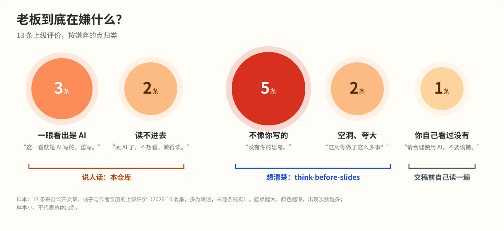

# 让 AI 说人话

**中文** | [English](README.en.md)

> "不说人话，太 AI 了，不想看，懒得读。"
>
> "这个你自己看过没有？请合理使用 AI，不要偷懒。"
>
> "这报告是 AI 写的吧？没有你的思考。"
>
> "写得不错……就是不太像你写的。"
>
> "这周你做了这么多事？我怎么不知道。"

用 AI 写汇报的人，多半听过其中一句。



前两句是作者亲历，其余来自公开文章和帖子，13 条原话和出处见 [docs/boss-quotes.md](docs/boss-quotes.md)。

老板嫌的点大致分三类：
- **读不进去、一眼看出是 AI**：这个仓库管。7 条能逐条检查的写作规则，让 AI 写出来的中文读得进去。
- **不像你写的、没内容、夸大**：要先想清楚自己要说什么，用配套的 [think-before-slides](https://github.com/robox888/think-before-slides)。
- **你自己看过没有**：工具替不了，交稿前自己读一遍。

---

## 一份被打回的周报

下面是一个构造的例子，原型是一个真实翻车案例（见本节末尾）。

**自己记的流水账**（交给 AI 的原料）：

> 参加了评审会；搭了个数据看板；看了下用户反馈的分析流程。

**AI 写出来的周报**：

> 本周，在团队的共同努力下，项目整体推进顺利。值得注意的是，本人深度参与了产品战略研讨，主导搭建了核心业务数据监控体系，有效赋能了业务决策闭环。同时，对用户反馈数据分析流程优化方案进行了系统性梳理。综上所述，本周各项工作取得阶段性成效。

<details>
<summary><b>问题标在哪（点开）</b></summary>

上标是下面规则的编号，⁰ 是"不改原意"。

> **本周，在团队的共同努力下，项目整体推进顺利**⁷。**值得注意的是**⁷，本人**深度参与了产品战略研讨**⁰，**主导搭建了**⁰**核心业务数据监控体系**²，**有效赋能了业务决策闭环**⁴。同时，对**用户反馈数据分析流程优化方案**²进行了系统性梳理。**综上所述，本周各项工作取得阶段性成效**⁷。

- ⁰ "参加评审会"变成"深度参与产品战略研讨"，"搭了个看板"变成"主导搭建"。功劳被放大了，老板一问就露馅
- ² 名词一层层叠上去，读者要自己拆
- ⁴ "赋能决策闭环"，平时没人这么说话
- ⁷ 开头、结尾都是套话，删掉不少任何信息

</details>

**按规则改写后**：

> 本周做了三件事：
> 1. 参加了评审会。[待确认：评审的是什么，会上定了什么]
> 2. 搭了一个数据看板。[待确认：看哪些数据，上线了没有，谁在用]
> 3. 看了用户反馈的分析流程。[待确认：发现了什么问题，下一步做什么]

改完一看，方括号里的才是真正要补的内容。老板想看的就是这些，AI 编不出来。

原型案例：AI 把"参加评审会"写成"深度参与产品战略研讨"，领导回了一句"这周你做了这么多事？我怎么不知道"（[出处](https://post.smzdm.com/p/a267e562/)）。

---

## 7 条规则

上面周报里标出来的问题，归纳起来就是下面 7 条，外加一条底线：**改写不改原意**。原文没说的原因、数字和功劳，一律不替作者补，缺的地方标"待确认"。

| # | 规则 | AI 常这样写 | 人会这样写 |
|---|---|---|---|
| 1 | 句子之间的关系要写出来 | 转化率降了 3%。工单量没变。先不回滚。 | 转化率降了 3%，不过工单量没变，我们判断影响有限，所以先不回滚。 |
| 2 | 名词前的修饰语不超过两层 | 请提交用户行为数据分析模型优化方案。 | 我们有一个分析用户行为数据的模型，请针对它提交优化方案。 |
| 3 | 少让抽象概念当主语做动作 | 这个框架吞噬了团队大量时间。 | 团队在这个框架上花了大量时间。 |
| 4 | 搭配要日常，注意断词 | 对齐颗粒度、赋能闭环、日历化 | 核对细节、把流程跑通、排进日程 |
| 5 | 用常见词，一个概念一种说法 | 该方法……该范式……这一路径…… | 这个方法……它……它…… |
| 6 | 局部顺，整体有长有短 | 三句一样长，都是"……从而……" | 长句后跟一句短句或一个例子 |
| 7 | 砍掉套话和过度作答 | 这是个好问题。在当今……综上所述…… | 先给结论，再给理由 |

每条规则的更多例子，以及故障说明、产品介绍、技术说明 3 个完整场景，见 [docs/examples.md](docs/examples.md)。

---

## 开始用

**装成 Skill**（以 Claude Code 为例）：

```bash
git clone https://github.com/robox888/human-readable-chinese-writing.git \
  ~/.claude/skills/human-readable-chinese-writing
```

之后让 AI 写汇报、润色或"去 AI 味"时，它会按 7 条规则写，交付前逐条自检。其他支持 `SKILL.md` 的工具，放进各自的 skills 目录即可。

**只要规则**：把 [rules/AGENTS-snippet.md](rules/AGENTS-snippet.md) 里的内容贴进项目的 `AGENTS.md`、`CLAUDE.md` 或系统提示词。

**两个一起用**：先用 [think-before-slides](https://github.com/robox888/think-before-slides) 理清目的、论据和大纲，再用这个仓库把正文写成人话。

---

## 为什么 AI 写的中文难读

2026 年有一批研究专门回答了这个问题：

- 一种解释是：前沿模型的后训练（预训练之后针对特定任务的训练）偏重数学、代码和推理，答对有奖励，说清楚没有，输出太长还可能被扣分。模型因此倾向用更少的词塞进更多信息。提出这个解释的论文用一个限制输出长度的训练实验做了初步验证。
- 研究观察到，AI 文本里名词堆叠、生僻搭配、抽象主语都比人类写作多。AI 改写后的文章词数少了，每个词的预测阅读时间反而更长。
- AI 还爱换同义词、堆套话、一个问题给好几个答案。在一项问答研究里，65.7% 的 AI 回答堆了重复选项，人类专家的采纳答案只有 4.4%。

9 篇论文的出处、关键数字和证据强度，见 [docs/evidence.md](docs/evidence.md)。

---

## 仓库里有什么

| 文件 | 给谁读 | 内容 |
|---|---|---|
| `SKILL.md` | AI | Skill 主文件：触发条件、7 步写作流程、自检清单 |
| `rules/AGENTS-snippet.md` | AI | 可直接贴进 `AGENTS.md` / `CLAUDE.md` 的规则 |
| `README.md` / `README.en.md` | 人 | 本页 |
| `docs/examples.md` | 人 | 全部改写示例 |
| `docs/boss-quotes.md` | 人 | 圆点图用的 13 条上级评价及出处 |
| `docs/evidence.md` / `docs/evidence.en.md` | 人 | 研究依据与证据强度 |
| `assets/` | 人 | 图片；`assets/src/` 里是圆点图的数据和生成脚本 |

---

## 局限

- 9 篇论文里只有 1 篇研究中文，把结论用到中文是推断。
- "两层""两句"这类数字是经验值，论文里没有。
- 那项问答研究也发现，58.3% 的情况下参与者觉得 AI 的回答更好读。"好读"和"简洁、准确"不总是一回事。
- 上级评价样本只有 13 条，多为转述，只能说明大致分类。
- 规则管的是好不好读，内容对不对要另外检查。

## 参与

欢迎在 [Issue](https://github.com/robox888/human-readable-chinese-writing/issues) 里贴你的改写前后对比、你听到的老板原话，或者指出规则不适用的场景。

## License

[MIT](LICENSE)
